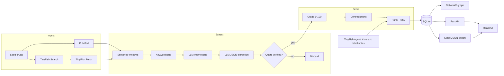

# NeuroRx: MVP execution, workflow, tech and progress

Evidence-graded drug-repurposing knowledge graph for adult neurogenesis in Alzheimer's disease.
Live demo (static build): https://frontend-beta-flame-22.vercel.app/#/ · Repo: https://github.com/Mayank130-sm/nxp

Output is a hypothesis for lab testing, not a treatment claim.

---

## 1. The idea

Adult neurogenesis is impaired in Alzheimer's. Papers report that dozens of approved drugs raise or lower it, but the evidence is scattered across species, markers and doses, and it often disagrees. A lab cannot read it all, so it cannot tell which drug is worth a bench test.

**MVP promise:** every drug claim is linked to a paper and a verbatim quote, graded 0-100, flagged when contradicted, and ranked with a plain-language reason.

**Who it is for:** preclinical labs and translational researchers choosing which approved drug to test next, and reviewers who need to audit why a drug was suggested.

---

## 2. MVP scope

| In the MVP | Deliberately left out |
|---|---|
| 28 seed drugs (4 positive controls, 3 negative controls, 21 candidates) | A full literature crawl of all neuro papers |
| PubMed abstracts as the backbone, open-access full text where available | Paywalled full text |
| Quote-grounded claim extraction, per-claim grading, contradiction detection | Causal or dose-response modelling |
| Ranking with a "why", safety flags, positive and negative controls | Clinical recommendations of any kind |
| React UI, FastAPI backend, static JSON fallback | User accounts, saved workspaces |
| TinyFish Search, Fetch and Agent as the web layer | Continuous re-crawl or scheduling |

Product rules that shaped every decision:
1. A claim without an exact source quote is discarded.
2. Contradictions are shown side by side, never merged.
3. Suppressors get a safety flag, not a hidden score.
4. Missing evidence is shown as "unknown", never as zero.

---

## 3. Workflow (end to end)

```
seed drugs
   |
   v
TinyFish Search  -> ranked open-access URLs per drug and stage
PubMed E-utilities -> abstract backbone (esearch / efetch)
   |
   v
TinyFish Fetch   -> clean Markdown of Methods and Results
   |
   v
Keyword gate (drug + neuro vocabulary) over sentence windows
   |
   v
LLM pass 1: yes/no "reports an effect?"  (cheap gate)
   |
   v
LLM pass 2: strict JSON extraction (temperature 0)
   |
   v
Quote verification: exact substring after whitespace normalisation, else discard
   |
   v
Deterministic species / study design from the quote, then the paper
   |
   v
Grading (0-100 per claim) -> contradiction detection -> ranking -> graph
   |
   v
TinyFish Agent -> ClinicalTrials.gov trial lists and drug-label BBB notes (no API exists)
   |
   v
FastAPI + static JSON export -> React UI (ranking, drug page, graph, methods)
```

**Grading weights (sum 100):** replication 25, study design 25, markers 20, species 20, dose / blood-brain-barrier 10.
**Penalties:** single lab -10, contradiction -15, unverified quote -50.
**Ranking:** strongest claim per paper, mean of the top three per-paper confidences. `score = 100*pro - 80*anti - conflict penalty (strong 10, weak 5, cap 25) + pathway bonus (5 each, cap 15)`, clamped to 0-100. A safety flag is set when anti evidence is at least as strong as pro evidence.

---

## 4. Tech stack

| Layer | Choice | Why |
|---|---|---|
| Web layer | TinyFish Search, Fetch, Agent | Search and Fetch for open pages; Agent for sites with no API (ClinicalTrials.gov, DailyMed) |
| Abstracts | PubMed E-utilities | Authoritative abstract backbone, polite rate limiting |
| Extraction | Ollama, `qwen3.6:35b` on a GPU server | Local model, strict JSON schema, no data leaves our infrastructure |
| Storage | SQLite with checkpoints | Resumable pipeline, zero setup |
| Graph | NetworkX, exported to JSON | Edges: ranked_for, affects_stage, engages_pathway |
| API | FastAPI | `/health`, `/drugs`, `/drugs/{name}`, `/graph`, `/stats` |
| Frontend | React 19, Vite, TypeScript, Tailwind 3, framer-motion, react-force-graph-2d, recharts, react-router (HashRouter) | Fast build, interactive graph and charts |
| Hosting | Vercel (static build) | Falls back to `/data/*.json` when no API is set |
| Quality | pytest (27 tests), ruff, Playwright screenshots | Fast feedback and visual checks |

**TinyFish client features:** on-disk cache keyed by endpoint and params, token-bucket rate limiting, retries with backoff, dry-run mode, a call log in `data/tinyfish_calls.jsonl`, and an agent-run cap per process.

---

## 5. Architecture



Key design choices:
- **Quote grounding is the trust anchor.** The LLM proposes, a plain string check disposes. Nothing unverified reaches grading.
- **Two-stage LLM** keeps cost down: a cheap yes/no gate before the strict extraction.
- **Deterministic context** (species, design) is derived from the quote and paper text, not asked of the model.
- **Static fallback:** the same UI runs from exported JSON when the API is not available, so the hosted demo needs no backend.

---

## 6. Technical feasibility

| Question | Finding |
|---|---|
| Can we get the literature? | Yes. PubMed gives abstracts for all 28 drugs; TinyFish Fetch gave full text for 87 papers. Paywalled papers stay abstract-only. |
| Can an LLM extract usable claims? | Yes, with guardrails. 478 claims proposed, 97.9% had a quote that verified exactly. |
| Is extraction fast enough? | Yes after changes. CPU runs took 20-40 s per call. A GPU server, a cheap gate pass and `think: false` brought calls to about 1 s. |
| Can we reach sites with no API? | Partly. TinyFish Agent returned trial lists and label notes for most drugs; some runs time out (sildenafil has no trial list). |
| Does grading add value over vote counts? | Not on control separation. On this small control set a plain vote count separated controls as well as the grading. The value is the per-claim explanation and the conflict and single-lab penalties. Reported honestly on the Methods page. |
| Can it run without a backend? | Yes. Static JSON export plus HashRouter deploys as a plain static site. |
| Cost and limits | TinyFish Search 30 req/min (free up to 12k/day), Fetch 150 URLs/min (1000/day free), Agent run cap of 30 per process. 180 live TinyFish calls used in total. |

**Main risks**
- Small corpus, mostly abstracts, so "no claim" means "no extracted evidence".
- Species and design precision is low by construction, because the gold labels only what a sentence states while the pipeline also falls back to the paper's dominant species.
- Gold labels are AI-made, not human (see section 8).

---

## 7. Progress: idea to now

| Phase | What was built |
|---|---|
| P0 Setup | Repo, `.env`, Makefile, config, TinyFish client with cache, rate limit and call log, smoke tests for TinyFish and Ollama |
| P1 Ingest | Seed drug list, PubMed client, TinyFish search and fetch, paper de-duplication by PMID, DOI and title, resumable checkpoints |
| P2 Extract | Keyword gate, two-pass LLM extraction, strict schema, exact-quote verification, duplicate removal, deterministic species and design |
| P3 Grade and rank | Per-claim grading, contradiction detection, top-3-mean ranking, safety flags, plain-language "why", NetworkX graph |
| P4 API and UI | FastAPI endpoints; React pages for ranking, drug detail, graph and methods; static JSON fallback |
| P5 Validation | Control recovery, ablation vs vote count, extraction eval, results files, slide numbers, README and DEMO script |
| P6 Agents | TinyFish Agent for ClinicalTrials.gov and drug-label notes, with a fill-gaps mode and a run cap |
| P7 Polish | Cross-platform one-command launcher (`make dev`), Playwright screenshots, Vercel deploy, two-annotator gold set, landing-style monochrome redesign with an animated pipeline and particle hero |

**Problems found and fixed along the way**
- Species and design were over-assigned as human clinical, which inflated scores. Replaced with stricter context rules.
- Noisy-OR scoring saturated near 100, so ranking switched to the top-3 mean.
- Blood-brain-barrier notes saying "does not state" were scored as positive. Added an "unstated" case and a test.
- Extraction was too slow on CPU. Added the gate pass and moved to a GPU server.
- Overlapping windows created duplicate claims. Added overlap de-duplication.
- Several UI crashes and layout issues in the graph and drug pages were fixed and re-checked with screenshots.

---

## 8. Where it stands now

| Metric | Value |
|---|---|
| Papers processed | 453 (87 with full text), 130 with at least one claim |
| Verified claims | 399 (97.9% of proposed claims had an exact quote) |
| Drugs | 28 seeded, 27 scored |
| Conflicts flagged | 23 |
| Controls recovered | 6 of 7 |
| TinyFish live calls | 180 (search 85, fetch 29, agent 66) |
| Tests | 27 passing, ruff clean |
| Extraction vs gold set | claim detection precision 89% / recall 89% (n=100); direction F1 97.5%; stage F1 92.5%; species precision 50%; study design precision 47% |
| Gold-set agreement | Two AI annotators, Cohen's kappa 0.72 on claim detection (86/100 raw), disagreements adjudicated by Claude |

**Known limits (also stated in the README and on the Methods page)**
1. The gold set was labelled by AI, not by a human. Treat the extraction numbers as a sanity check and have a person relabel `data/labels/gold_sentences.csv` before quoting them as a result.
2. Dexamethasone found no attributable evidence, because its papers discuss glucocorticoids as a class. It is reported as unknown and was deliberately not tuned.
3. Sildenafil has no trial list because its Agent lookup timed out. A missing trial list means "not retrieved", not "no trials exist".
4. Grading does not beat a plain vote count on control separation.
5. Independent papers are distinct papers; shared-lab authorship is not detected.

**Next steps if continued**
- Human relabelling of the gold set, then re-run `scripts/eval_extraction.py` and the build.
- More full text and a larger drug list.
- Better handling of drug classes (for example glucocorticoids) and abbreviations.
- Scheduled re-crawls and a reviewer workflow for disputed claims.

---

## 9. Run it

```bash
make setup      # venv + dependencies + npm install
make dev        # API on :8000 and UI on :5173, wired together
make test       # 27 tests
python scripts/run_pipeline.py            # full pipeline
python scripts/run_pipeline.py --stage build   # grade, validate, export static JSON
```

Related files: `README.md` (setup, scoring method, limitations), `DEMO.md` (3-minute demo script), `results/validation.md`, `results/slide_numbers.md`, `results/screens/`.
