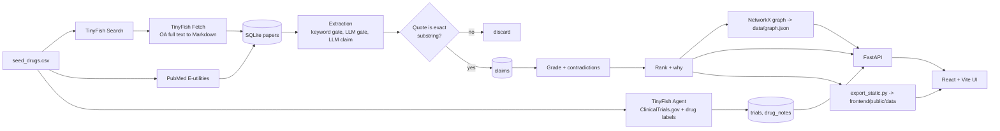

# NeuroRx

**An evidence-graded drug-repurposing knowledge graph for neurogenesis in Alzheimer's disease.**

NeuroRx turns scattered, contradictory neurogenesis literature into a searchable graph where every drug-to-neurogenesis claim is linked to a paper, given a confidence grade, and flagged when contradicted, so labs can decide which approved drugs deserve testing.

> **Every output is a hypothesis for lab testing, never a treatment claim.** No paper, PMID, dose, quote or number is invented. Missing data is shown as "unknown", never as "no effect".

## Problem

Adult neurogenesis is impaired in Alzheimer's disease, and many approved drugs have been reported to raise or lower it. The evidence is spread over thousands of papers in different species, with different markers and doses, and it often disagrees. Nobody can read it all, and a drug "that works in mice" is not the same as one that deserves a human-relevant test.

## What it does

1. **Finds** papers per drug with TinyFish Search and PubMed.
2. **Reads** them with TinyFish Fetch (open-access full text as clean Markdown) and PubMed abstracts.
3. **Extracts** sentence-level claims with an LLM, then **verifies that each quote is an exact substring of the source**. Claims whose quote does not verify are discarded.
4. **Grades** each claim 0-100, **flags contradictions** side by side, and **ranks** drugs with a plain-language "why".
5. **Shows** it in a React app: ranking, drug evidence, graph explorer, methods and validation.

## Architecture



## TinyFish usage

| Product | Used for | Where |
|---|---|---|
| **Search** | 3 queries per drug (`<drug> adult hippocampal neurogenesis DCX BrdU`, `... neural stem cell proliferation Alzheimer`, `... neurogenesis impairment`); ranked URLs, open-access hosts kept | `backend/app/ingest.py` |
| **Fetch** | Open-access article pages (PMC, bioRxiv, Europe PMC) to Markdown; Abstract / Methods / Results kept | `backend/app/ingest.py` |
| **Agent** | Only where no API exists: ClinicalTrials.gov trial lists and drug-label BBB/safety notes, capped at 30 runs | `backend/app/agents.py` |
| Browser | Not used (optional stretch) | n/a |

`backend/app/tinyfish_client.py` is a thin typed wrapper: key only from env, on-disk cache keyed by hash of the request, token-bucket rate limiting (30 searches/min, 150 fetch URLs/min per the live docs), exponential backoff on 429/5xx, `--dry-run` (cache only), and a call log at `data/tinyfish_calls.jsonl` that feeds the real counts shown in the app (`/stats`).

Where the live docs differ from the original brief (the docs were treated as the source of truth): Fetch takes `format` (not an output option) and at most 10 URLs per call; Search is free up to 12,000 requests per day and Fetch up to 1,000 URLs per day; the sync Agent endpoint is `/v1/automation/run` with an optional `output_schema`.

## Setup

Requirements: Python 3.11, Node 20+, an [Ollama](https://ollama.com) server, a TinyFish API key.

```bash
cp .env.example .env            # fill TINYFISH_API_KEY, NCBI_EMAIL, OLLAMA_HOST, OLLAMA_MODEL
make setup                      # venv, pip, npm install
python scripts/smoke_tinyfish.py   # one real search, fetch and agent goal
python scripts/smoke_ollama.py
python scripts/run_pipeline.py     # ingest -> extract -> agents -> build (resumable, Ctrl-C safe)
make dev                        # same as: python scripts/dev.py  (API :8000 + UI :5173, Ctrl-C stops both)
make test                       # pytest
```

`OLLAMA_MODEL` defaults to `qwen2.5:7b-instruct`; the shipped results used the model recorded in `claims.extractor_model` (shown on the Methods page). The LLM sits behind a small interface (`backend/app/llm.py`), so a hosted model can be swapped in.

**Static deployment (no backend, e.g. Vercel):** `python scripts/export_static.py`, then deploy `frontend/` (build `npm run build`, output `dist`). With `VITE_API_URL` unset the app reads `public/data/*.json`.

## Scoring method

Per-claim confidence (0-100), computed in `backend/app/grade.py`; weights live in `backend/app/config.py`.

| Component | Weight | How it is scored |
|---|---|---|
| Replication across independent papers | 25 | 1 paper = 0.2, 2 = 0.6, 3 or more = 1.0 |
| Study design | 25 | human clinical 1.0, non-human primate 0.8, human cells/organoid 0.7, rodent 0.6, in vitro 0.4, review 0.3, unknown 0.2 |
| Marker validity | 20 | distinct marker classes among proliferation (BrdU, Ki67), immature (DCX), mature (NeuN) and stem (SOX2, nestin); 3 classes = full marks |
| Species relevance | 20 | human 1.0, monkey 0.8, mouse or rat 0.6, other 0.3, unknown 0.2 |
| Dose / BBB plausibility | 10 | dose stated 0.5, plus 0.5 if the drug label says it acts on the CNS (0.15 if unknown) |
| **Penalties** | | single paper -10, contradiction present -15, unverified quote -50 |

**Contradictions:** for each (drug, stage), verified claims that disagree in direction are flagged and shown side by side ("strong" = increase vs decrease, "weak" = one side reports no effect).

**Ranking** (`backend/app/rank.py`): per drug, the strongest claim per paper is kept (claims from one paper are not independent), aggregated as the mean of the top 3 per-paper confidences (replication is already inside each claim's confidence, so the score rewards evidence quality, not claim count), then `score = 100*pro - 80*anti - conflict penalty (strong 10, weak 5, cap 25) + pathway bonus (5 per BDNF/TrkB, Wnt, Notch, mTOR, CREB or Shh hit, cap 15)`, clamped to 0-100. Drugs whose anti-neurogenic evidence is at least as strong as the pro evidence get a **safety flag**, not an opportunity score.

## Validation

`python scripts/validate.py` writes `results/validation.md` and `results/validation.json`: control recovery (positive: fluoxetine, lithium, metformin, memantine; negative: dexamethasone, morphine, ethanol), the ranking ablation with vs. without evidence grading, and the fraction of LLM-proposed claims whose quote verified. `scripts/eval_extraction.py` computes per-field precision/recall/F1 against `data/labels/gold_sentences.csv` (`scripts/make_gold_template.py` generates the 100-row template; the shipped labels are AI-made, see Limitations). Disagreements with a control are reported as they are.

## Limitations

- Small corpus (abstract-heavy; full text for only a minority of papers), so absence of a claim is absence of *extracted* evidence.
- Species and study design fall back to deterministic paper-level word counts when the claim sentence does not state them.
- Sentence-level extraction misses effects stated across several sentences and results only in figures.
- "Independent" papers are distinct papers; shared-lab authorship is not detected.
- Drug-name matching uses a synonym list; unusual abbreviations are missed.
- The 100-sentence gold set (`data/labels/gold_sentences.csv`) was labelled by Claude, an AI, not by an independent human annotator. Treat the extraction metrics as a sanity check and replace the labels with human ones before quoting them as a result. Species/design precision is low by construction (the gold labels only what the sentence states; the pipeline falls back to the paper's dominant animal species).
- Markdown formatting characters are stripped before quote checking, so a quote is verified against the formatting-stripped text.

## Honesty statement

This tool prioritises precision over recall. It never fabricates evidence, never hides contradictions, and shows missing data as unknown. Output is for generating hypotheses that a lab should test, not for treating patients.

## Layout

`backend/app/` pipeline and API, `scripts/` runnable steps (`run_pipeline.py`, `validate.py`, `export_static.py`, `screenshots.py`), `frontend/` React app, `data/` seed drugs, labels and caches (caches and DB are gitignored), `results/` validation report and screenshots.
