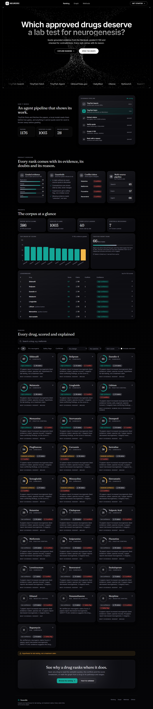
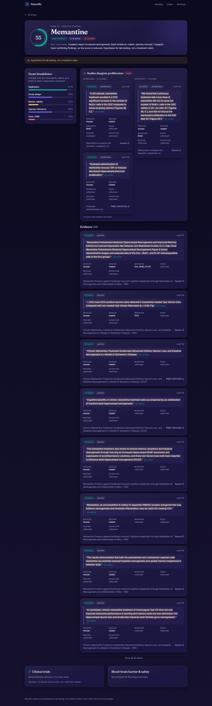
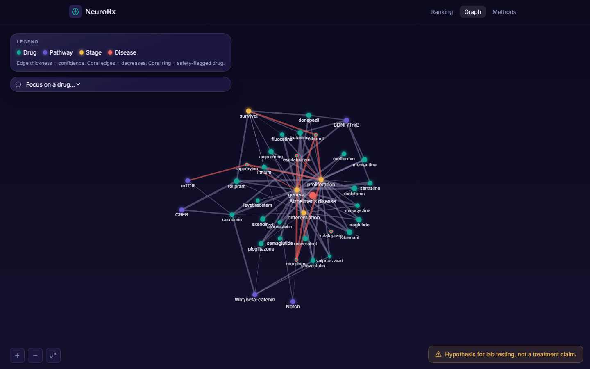
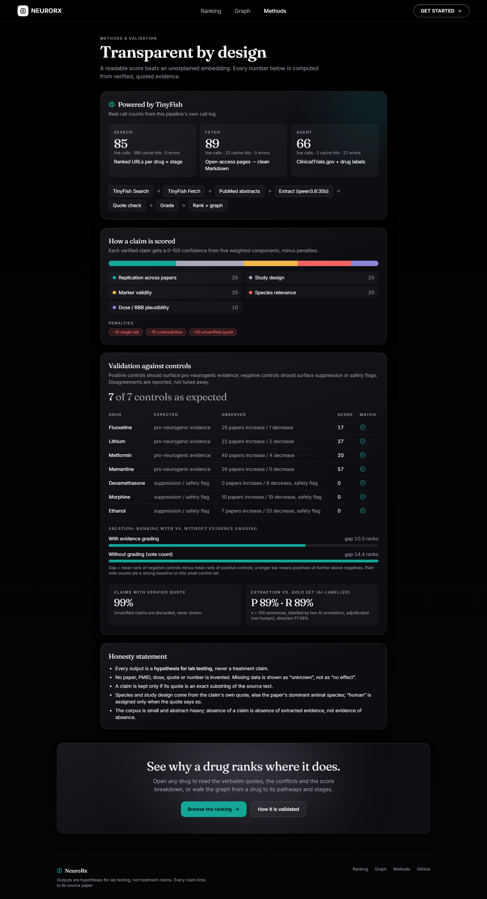
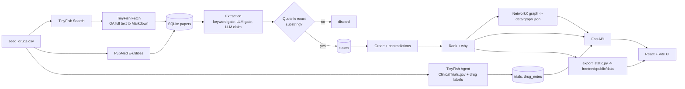

# NeuroRx

**An evidence-graded drug-repurposing knowledge graph for neurogenesis in Alzheimer's disease.**

**Live demo (static build):** https://frontend-beta-flame-22.vercel.app/#/

NeuroRx turns scattered, contradictory neurogenesis literature into a searchable graph. Every drug-to-neurogenesis claim is linked to a paper and a verbatim quote, given a 0-100 confidence grade, and flagged when other papers contradict it, so a lab can decide which approved drugs deserve a bench test.

> **Every output is a hypothesis for lab testing, never a treatment claim.** No paper, PMID, dose, quote or number is invented. Missing data is shown as "unknown", never as "no effect".



## Results at a glance

| | |
|---|---|
| Papers processed | **1,536** (298 with open-access full text, the rest PubMed abstracts) |
| Papers that yielded at least one claim | 521 |
| Verified claims (exact-quote grounded) | **1,288** |
| LLM-proposed claims whose quote verified | 98.5% (1,614 proposed, 24 rejected as not an exact substring) |
| Drugs scored | 28 (4 positive controls, 3 negative controls, 21 candidates) |
| Contradictions flagged | 45 |
| Controls recovered | **7 of 7** |
| TinyFish live calls | 240 (Search 85, Fetch 89, Agent 66), all logged |
| Tests | 27 passing, ruff clean |

Top-ranked candidates in the current run: sildenafil, rolipram, exendin-4, atorvastatin, liraglutide, memantine, donepezil. These are leads for testing, not findings. See [Validation](#validation) and [Limitations](#limitations) for what the numbers do and do not show.

## Problem

Adult neurogenesis is impaired in Alzheimer's disease, and many approved drugs have been reported to raise or lower it. The evidence is spread over thousands of papers, in different species, with different markers and doses, and it often disagrees. Nobody can read it all, and a drug "that works in mice" is not the same as one that deserves a human-relevant test.

## What it does

1. **Finds** papers per drug with TinyFish Search and PubMed.
2. **Reads** them with TinyFish Fetch (open-access full text as clean Markdown) and PubMed abstracts.
3. **Extracts** sentence-level claims with an LLM, then **verifies that each quote is an exact substring of the source**. A claim whose quote does not verify is discarded.
4. **Grades** each claim 0-100, **flags contradictions** side by side, and **ranks** drugs with a plain-language "why" and a safety flag where evidence points to suppression.
5. **Shows** it in a React app: ranking, per-drug evidence, graph explorer, and a methods and validation page.

Four rules shape every decision: a claim without an exact source quote is discarded; contradictions are shown side by side and never merged; suppressors get a safety flag, not a hidden score; missing evidence reads "unknown", not zero.

## Screens

| Drug evidence | Evidence graph | Methods and validation |
|---|---|---|
|  |  |  |

## Architecture



**Stack:** Python 3.11, FastAPI, SQLite, NetworkX, httpx, an Ollama-served LLM; React 19, Vite, TypeScript, Tailwind 3, framer-motion, react-force-graph-2d, recharts; pytest, ruff, Playwright for screenshots.

**Data layer:** `data/neurorx.db` (SQLite, committed, about 1.6 MB) holds papers, claims, scores, trials, notes and resumable checkpoints. The UI reads the FastAPI when `VITE_API_URL` is set, otherwise the static JSON exported to `frontend/public/data/`.

## TinyFish usage

| Product | Used for | Where |
|---|---|---|
| **Search** | 3 queries per drug (`<drug> adult hippocampal neurogenesis DCX BrdU`, `... neural stem cell proliferation Alzheimer`, `... neurogenesis impairment`); ranked URLs, open-access hosts kept | `backend/app/ingest.py` |
| **Fetch** | Open-access article pages (PMC, bioRxiv, Europe PMC) to Markdown; Abstract, Methods and Results sections kept | `backend/app/ingest.py` |
| **Agent** | Only where no API exists: ClinicalTrials.gov trial lists and drug-label blood-brain-barrier and safety notes, capped at 30 runs per process | `backend/app/agents.py` |
| Browser | Not used | n/a |

`backend/app/tinyfish_client.py` is a thin typed wrapper: key only from the environment, an on-disk cache keyed by a hash of the request, token-bucket rate limiting (30 searches/min and 150 fetch URLs/min per the live docs), exponential backoff on 429 and 5xx, a `--dry-run` mode (cache only), a configurable timeout (`TINYFISH_TIMEOUT`, default 150 s), and a call log at `data/tinyfish_calls.jsonl`. That log feeds the real counts shown on the Methods page and in `/stats`.

PubMed does not go through TinyFish: `backend/app/pubmed.py` calls NCBI E-utilities directly for the abstract backbone.

Where the live docs differ from the original brief (the docs were treated as the source of truth): Fetch takes `format` and at most 10 URLs per call; Search is free up to 12,000 requests per day and Fetch up to 1,000 URLs per day; the synchronous Agent endpoint is `/v1/automation/run` with an optional `output_schema`.

## Quick start

Requirements: Python 3.11, Node 20+. The pipeline also needs an [Ollama](https://ollama.com) server and a TinyFish API key. **The app itself needs neither**, because the repository includes the database and the exported data.

```powershell
# one-time install (macOS/Linux: use .venv/bin/python)
python -m venv .venv
.venv\Scripts\python -m pip install -r backend/requirements.txt
cd frontend; npm install; cd ..

# run the API (:8000) and the UI (:5173) together
.venv\Scripts\python scripts/dev.py
```

Open http://localhost:5173. For the UI alone, using the committed static data: `cd frontend; npm run dev`.

`make setup`, `make dev` and `make test` do the same where `make` is available. Full commands, including querying the database, are in **[RUN.md](RUN.md)**.

### Re-running or extending the pipeline

```powershell
copy .env.example .env             # fill TINYFISH_API_KEY, NCBI_EMAIL, OLLAMA_HOST, OLLAMA_MODEL
.venv\Scripts\python scripts/smoke_tinyfish.py    # one real search, fetch and agent goal
.venv\Scripts\python scripts/smoke_ollama.py
.venv\Scripts\python scripts/run_pipeline.py      # ingest -> extract -> agents -> build (resumable, Ctrl-C safe)
```

- **Add drugs:** append rows to `data/seed_drugs.csv` (`drug,synonyms,category`), then run the pipeline. Finished drugs are skipped.
- **More papers per drug:** `run_pipeline.py --stage ingest --reingest --pubmed-n 60 --fulltext-n 12`, then `--stage extract` and `--stage build`.
- **Stages:** `--stage ingest|extract|agents|build`; `--drugs a,b` limits any stage; `--dry-run` uses the cache only.
- A drug appears in the knowledge graph once it has at least one verified claim.

`OLLAMA_MODEL` defaults to `qwen2.5:7b-instruct` in `.env.example`; the shipped results were produced with `qwen3.6:35b` on a GPU server (recorded per claim in `claims.extractor_model` and shown on the Methods page). The LLM sits behind a small interface (`backend/app/llm.py`), so a hosted model can be swapped in.

**Static deployment (no backend, e.g. Vercel):** `python scripts/export_static.py` (done by the build stage), then deploy from the repository root (the Vercel project's root directory is `frontend`, build `npm run build`, output `dist`). With `VITE_API_URL` unset the app reads `public/data/*.json`.

## Scoring method

Per-claim confidence (0-100), computed in `backend/app/grade.py`; weights live in `backend/app/config.py`.

| Component | Weight | How it is scored |
|---|---|---|
| Replication across independent papers | 25 | 1 paper = 0.2, 2 = 0.6, 3 or more = 1.0 |
| Study design | 25 | human clinical 1.0, non-human primate 0.8, human cells/organoid 0.7, rodent 0.6, in vitro 0.4, review 0.3, unknown 0.2 |
| Marker validity | 20 | distinct marker classes among proliferation (BrdU, Ki67), immature (DCX), mature (NeuN) and stem (SOX2, nestin); 3 classes = full marks |
| Species relevance | 20 | human 1.0, monkey 0.8, mouse or rat 0.6, other 0.3, unknown 0.2 |
| Dose / BBB plausibility | 10 | dose stated 0.5, plus 0.5 if the drug label says it acts on the CNS (0.15 if the label is silent or unknown) |
| **Penalties** | | single paper -10, contradiction present -15, unverified quote -50 |

**Contradictions:** for each (drug, stage), verified claims that disagree in direction are flagged and shown side by side ("strong" = increase vs decrease, "weak" = one side reports no effect).

**Ranking** (`backend/app/rank.py`): per drug, the strongest claim per paper is kept (claims from one paper are not independent), aggregated as the mean of the top 3 per-paper confidences, then `score = 100*pro - 80*anti - conflict penalty (strong 10, weak 5, cap 25) + pathway bonus (5 per BDNF/TrkB, Wnt, Notch, mTOR, CREB or Shh hit, cap 15)`, clamped to 0-100. A drug whose anti-neurogenic evidence is at least as strong as its pro evidence gets a **safety flag**, not an opportunity score.

## Validation

`python scripts/validate.py` writes `results/validation.md` and `results/validation.json`. Everything below is computed from the database.

**Control recovery: 7 of 7.** Positive controls fluoxetine, lithium, metformin and memantine surface pro-neurogenic evidence; negative controls dexamethasone, morphine and ethanol surface suppression and carry safety flags. Dexamethasone was missed on the first, smaller corpus (its papers discuss glucocorticoids as a class) and was recovered only after more papers were ingested. We did not tune for it.

**Ablation: grading did not beat a plain vote count.** The control-separation gap (mean negative rank minus mean positive rank) is 10.5 with evidence grading and 14.4 with a plain vote count. The value of the grading is the per-claim explanation and the penalties for conflicts and single-paper evidence, not better control separation on this small set.

**Quote grounding:** 98.5% of LLM-proposed claims had a quote that was an exact substring of the source (1,614 proposed, 24 rejected).

**Extraction vs. a gold set** (`scripts/eval_extraction.py`, 100 sentences, labelled by two AI annotators, see Limitations): claim detection precision 89% and recall 89%; direction F1 97.5%; stage F1 92.5%; species precision 50% (recall 100%); study-design precision 47% (recall 94%). Species and design precision are low by construction: the gold labels only what a sentence states, while the pipeline also falls back to the paper's dominant animal species.

Disagreements with a control are reported as they are.

## Limitations

- **Gold labels are AI-made.** The 100-sentence gold set (`data/labels/gold_sentences.csv`) was labelled by two AI annotators (Claude; the second labelled blind, without seeing the first), with disagreements adjudicated by Claude against a written rule: raw agreement 86/100 on claim detection, Cohen kappa 0.72; stage agreed on 36/39 and every other field on 39/39. Neither annotator is human, and both are the same model family, so errors are correlated. Treat the extraction metrics as a sanity check and replace the labels with human ones before quoting them as a result: `python scripts/make_human_sheet.py` writes a blank sheet, and `scripts/eval_extraction.py --gold <file>` scores against it.
- **Some positive controls rank low.** Fluoxetine (score 17) and metformin (score 20) have many more increasing than decreasing papers but score low; lithium dropped from 58 to 27 and ketamine, resveratrol and valproic acid score near zero after more papers were added. These movements have not been investigated.
- **Grading does not improve control separation** over a vote count (see Validation).
- **Small, abstract-heavy corpus:** full text for 298 of 1,536 papers, so the absence of a claim means the absence of *extracted* evidence.
- Species and study design fall back to deterministic paper-level word counts when the claim sentence does not state them.
- Sentence-level extraction misses effects stated across several sentences and results shown only in figures.
- "Independent" papers are distinct papers; shared-lab authorship is not detected.
- Drug-name matching uses a synonym list, and drug classes are not mapped to drugs (for example glucocorticoids to dexamethasone); unusual abbreviations are missed.
- Markdown formatting characters are stripped before quote checking, so a quote is verified against the formatting-stripped text.
- TinyFish Agent trial lookups returned lists for most drugs but not all: sildenafil's lookup completed but returned no trials. Absence of trials in the app means "not retrieved", not "no trials exist".
- Hosting: the demo is a static build. Vercel temporary deployments expire, so deploy `frontend/` from your own Vercel account (`vercel.json` is set) or run `scripts/dev.py`.

## Honesty statement

This tool prioritises precision over recall. It never fabricates evidence, never hides contradictions, and shows missing data as unknown. Output is for generating hypotheses that a lab should test, not for treating patients.

## Repository layout

```
backend/app/      pipeline (ingest, extract, grade, rank, graph, agents), TinyFish and Ollama clients, FastAPI
backend/tests/    27 tests (client, ingest, extraction, grading and ranking, end to end)
scripts/          run_pipeline, dev, validate, export_static, eval_extraction, make_human_sheet, screenshots, ...
frontend/         React app (src/pages, src/landing.tsx, src/ui.tsx), vercel.json
data/             seed_drugs.csv, labels/, neurorx.db, graph.json (caches, logs and backups are gitignored)
results/          validation report, extraction eval, slide numbers, screenshots
```

## More documentation

- [RUN.md](RUN.md): run, test, extend the pipeline, query the database, deploy.
- [MVP.md](MVP.md): scope, workflow, tech stack, feasibility, architecture and progress from idea to now.
- [DEMO.md](DEMO.md): the 3-minute demo script with the real numbers.
- `results/validation.md`, `results/slide_numbers.md`: generated reports.
